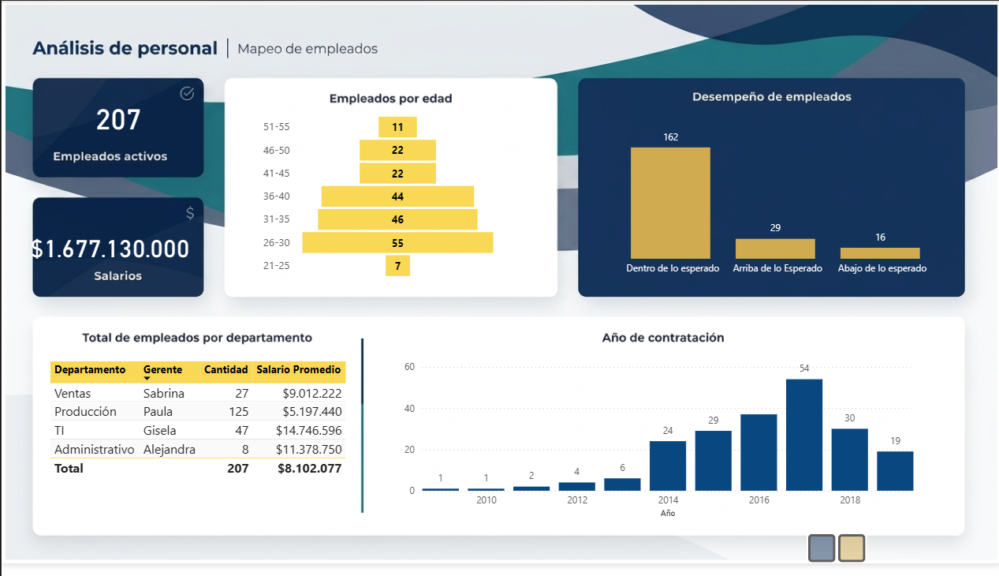

# Power BI Dashboards

A collection of Power BI dashboards that turn operational data into decisions. Each one starts from a business question, documents its data and model, and closes with the insights the data supports.

## Dashboards

### [HR Dashboard – Análisis de personal](dashboard-RH/)
Workforce analysis for an HR lead: active headcount, monthly payroll in guaraníes, age distribution, performance, hiring trends, and a summary by department.

- **Three switchable themes** (blue, gold, dark): bookmarks swap the background, and DAX color measures change the chart colors to match
- **Remodeled data:** department heads linked to the employee table by ID through a Power Query merge
- **Explicit DAX measure** for active headcount



### [Customer Service Tracking – Seguimiento de Servicios](dashboard-ATC/)
Call center performance in one page: call volume, resolution rate, wait time and customer satisfaction by agent, area and date.

- KPI cards, resolution breakdown, calls by agent, area and date with drill-down
- Custom background design
- Insights on where a supervisor should focus first


## Skills shown

| Area | What's used |
|---|---|
| **Business analysis** | Framing each dashboard around a business question; documenting data, model and insights |
| **Data preparation** | Power Query: type changes, column splits, value replacement, age buckets, merges between tables |
| **Data modeling** | Relationships between fact and dimension tables; avoiding ambiguous paths with merges |
| **DAX** | Explicit measures (`CALCULATE`, `DISTINCTCOUNT`); dynamic formatting with `SWITCH(SELECTEDVALUE())` |
| **Report design** | Custom backgrounds, bookmarks, buttons, theme switching, conditional formatting |

## Repository structure

```
dashboards/
├── README.md
├── dashboard-ATC/
│   ├── README.md
│   ├── AtencionAlCliente.pbix
│   └── Datos_de _servicio.xlsx
└── dashboard-RH/
    ├── README.md
    ├── Dashboard_RH.pbix
    ├── data/
    ├── layout/
    └── screenshots/
```

## How to open
Download the `.pbix` file from a dashboard's folder and open it in **Power BI Desktop** (free, Windows). Each folder's README explains its data source and how to reconnect it if needed.

## About the data
All datasets are practice data, not real company data. Sources and any changes made to them are described in each dashboard's README.

---

**Macarena Chamorro Bykov** · Business Systems Analyst · [LinkedIn](https://www.linkedin.com/in/macarenachamorrobykov)
