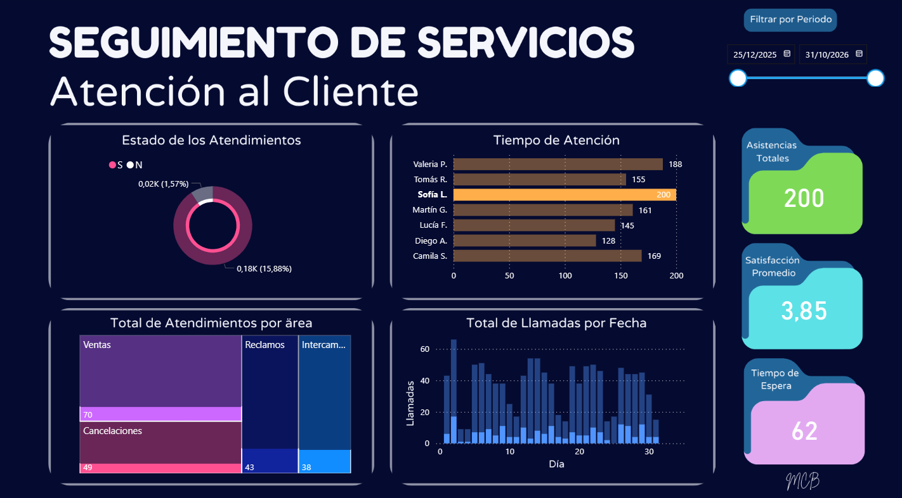
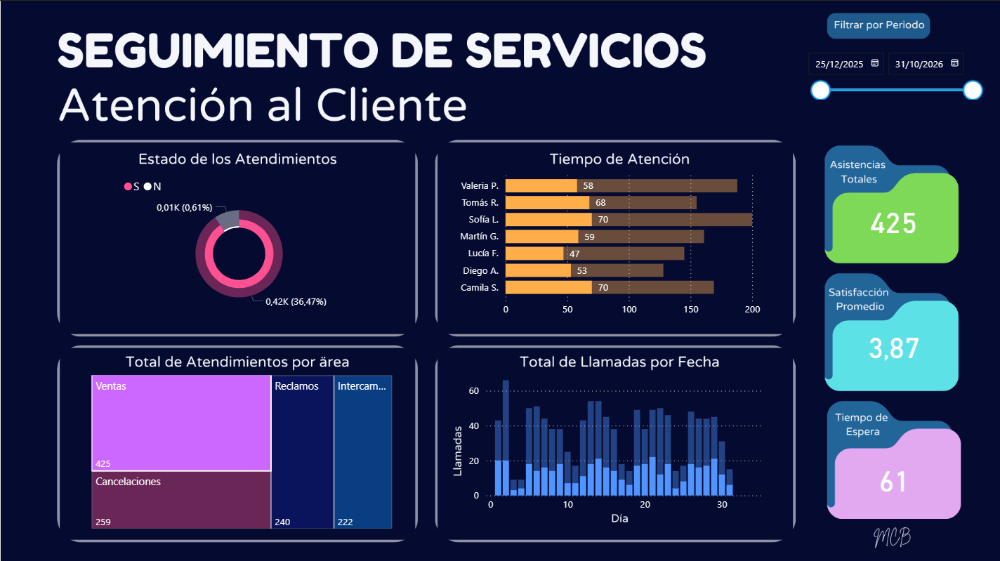

# Customer Service Tracking – Seguimiento de Servicios

A one-page Power BI dashboard for a customer service team: call volume, resolution, response speed and customer satisfaction, filterable by period.

*Filtered to one agent (Sofía L.): every chart and KPI recalculates for her calls.*

## Business question

How is the customer service team performing, and where should a supervisor focus? The dashboard gives a one-page view of call volume, resolution, response speed, and customer satisfaction, filterable by period.

## Data

`data/Datos_de_servicio.xlsx`, sheet `atenciones`: 1,146 customer service calls from October 2026.

**Data source:** synthetic dataset. The table structure comes from a practice exercise; every value (call IDs, dates, agents, areas, outcomes, times and satisfaction scores) was randomly generated. This is not real company data.

| Field | Description |
|---|---|
| Id Llamada | Call ID |
| Fecha | Call date |
| Asistente | Agent who handled the call (7 agents) |
| Área | Service area: Sales, Cancellations, Exchanges, Complaints |
| Respondido - Resuelto (S/N) | Whether the call was answered and resolved |
| Velocidad de respuesta | Time to answer, in seconds |
| Duración con asistente en segundos | Time spent with the agent, in seconds |
| Índice de satisfacción | Customer satisfaction score (1–5) |

The workbook also includes an `i18n` sheet with English/Spanish labels for every dashboard element, prepared for a bilingual version of the report.

## What the dashboard shows
- **Total calls**, **average satisfaction**, and **average wait time** as KPI cards
- **Resolution status**: share of calls resolved vs. not resolved (donut chart)
- **Calls per agent** (bar chart)
- **Calls by service area** (treemap)
- **Calls by date**, with drill-down by year, quarter, month, and day
- **Period filter** (date slicer)

## Key insights from the data
- **90.8%** of calls were resolved (1,040 of 1,146).
- **Sales** resolved 98.4% of its calls, while **Cancellations** had the lowest resolution rate (79.2%), which makes it the first area to review.
- **Average satisfaction is 3.74 / 5.** Complaints (*Reclamos*) score lowest (3.59) and Sales highest (3.87).
- **Agent performance varies:** Valeria P. has the highest satisfaction (3.98), while Martín G. has the lowest satisfaction (3.41) and the lowest resolution rate (85.7%), a candidate for coaching.
- Average **wait time is 63 seconds**, and the average call lasts **3 min 34 s** with the agent.
- **Sales** represents 37% of all calls (425).

## Interactivity
Every chart cross-filters the others. Selecting an agent, an area or a date updates the KPI cards and all other visuals.

| Filtered by agent (Sofía L.) | Filtered by area (Ventas) |
|---|---|
|  |  |

## Design

Dashboard design, custom background, data model and analysis by **Macarena Chamorro Bykov**. Dark theme with color-coded KPI cards for quick reading. The background source image is in `layout/`.

## Tools

Power BI Desktop, Power Query, Excel.

## How to open

Download `AtencionAlCliente.pbix` and open it in Power BI Desktop. The data source is `data/Datos_de_servicio.xlsx`; if prompted, update the file path under **Transform data → Data source settings**.

[← Back to all dashboards](../README.md)
