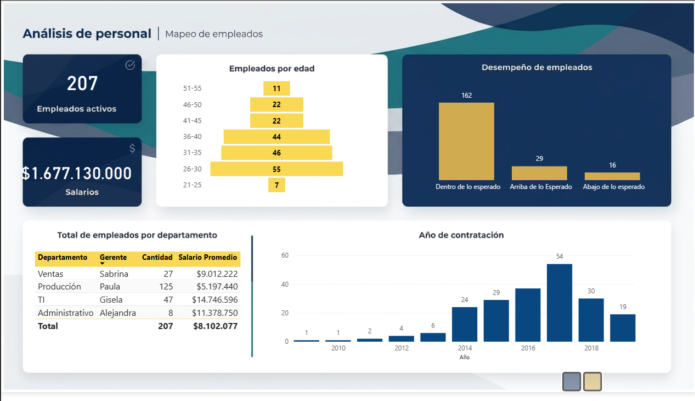
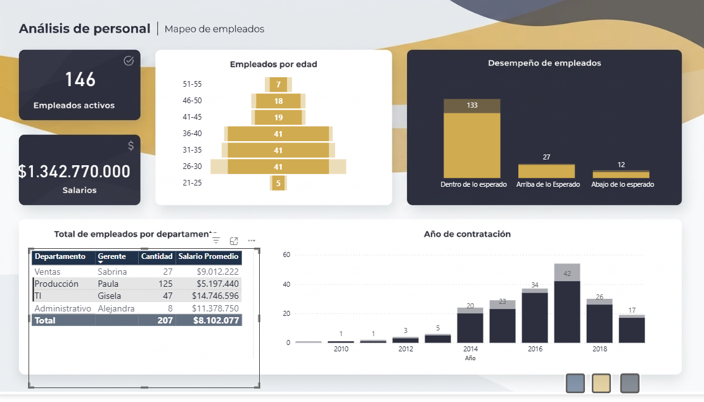
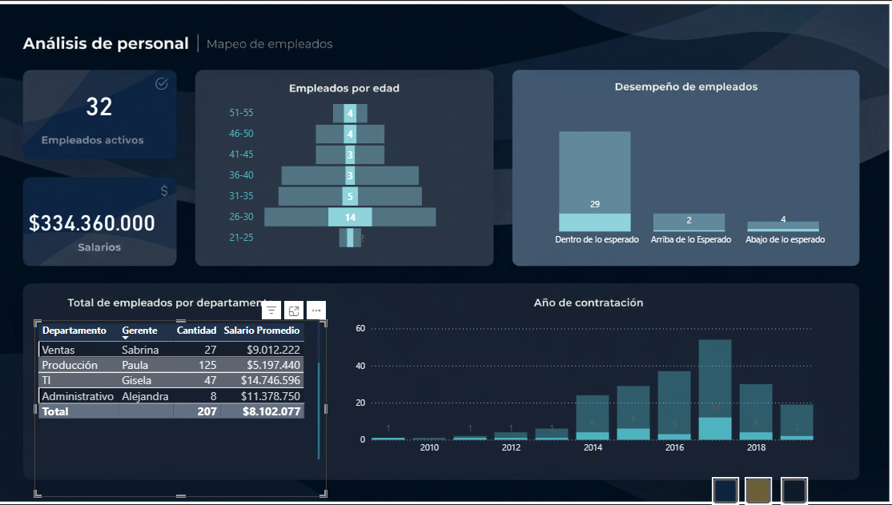

# HR Dashboard – Análisis de personal

A one-page Power BI dashboard for workforce analysis: headcount, payroll, age distribution, performance, hiring trends and a summary by department, with three switchable visual themes.

**Version 2.0**

## Business question
Who works in the company today, how are they distributed across departments and age groups, how are they performing, and what does payroll look like? The dashboard gives an HR lead a quick, single-page view of the workforce.

## Data
`data/bd_integrantes_Esp.xlsx`, two sheets:

| Sheet | Rows | Content |
|---|---|---|
| `integrantes` | 207 employees | Name, ID, salary and job title, birth date, age, sex, hire date, exit date, status, department, recruitment source, performance rating, satisfaction score |
| `departamentos` | 4 departments | Department code, name, and the employee ID of the department head (`id_responsable`) |

Salaries are monthly amounts in guaraníes (PYG).

**Data source:** dataset adapted from a Zakidata course exercise. Employee names, IDs, salaries, employment status and exit dates were replaced with fictional values, and the department heads were remodeled as employees linked by ID. This is not real company data.

## Data model and preparation (Power Query)
- `integrantes` → `departamentos`: many-to-one relationship on the department code.
- The combined `Salario-Cargo` field is split into **Salario** and **Cargo**.
- Age ranges (`Intervalo_edad`) are generated in 5-year buckets.
- Department heads are stored as an **employee ID**, not a plain name. Power Query merges `departamentos` with `integrantes` to bring in the head's name, so the head is part of the workforce data and stays consistent with it.

## What the dashboard shows
- **Active employees** and **total monthly payroll** as KPI cards
- **Employees by age range**
- **Employees by performance rating**
- **Employees by hiring year**
- **Summary by department:** headcount, average salary and department head

## Theme switcher
Three color swatches switch the whole page between a **blue**, a **gold** and a **dark** theme:
- Each background is an image layer, and **bookmarks** show the selected one and hide the others.
- Chart colors follow the theme through **DAX color measures**. A disconnected `Tema` table (Azul, Dorado, Oscuro) feeds a hidden slicer, and measures such as `Color Barras` and `Color Texto` use `SWITCH(SELECTEDVALUE(Tema[Tema]))` to return the right hex color. Bars, labels, axes and table text use these measures through conditional formatting.
- Each bookmark stores both the visible background and the slicer selection, so one click changes the background and the colors together.
- Table headers use a fixed dark band with white text, since header colors can't be formatted conditionally.

## Key insights from the data
- **178 of 207 employees are active** (86%); 29 have left the company.
- **Producción is the largest department** with 104 active employees (58%), followed by TI (42), Ventas (24) and Administrativo (8).
- **TI has the highest average salary** (about Gs. 14.4M per month), almost three times Producción's (about Gs. 5.2M), reflecting a more specialized workforce.
- **79% of active employees perform as expected**, 15% above expectations and 7% below.
- **Hiring peaked in 2017** (54 hires) and has slowed since.
- The active workforce is **58% women**, with a median age of 35.

## Design
Dashboard design, backgrounds, data model and analysis by **Macarena Chamorro Bykov**. The page layout is based on the original course exercise; the backgrounds were redesigned. Source images are in `layout/`.

| Blue theme | Gold theme | Dark theme |
|---|---|---|
|  |  |  |

## Tools
Power BI Desktop, Power Query, Excel.

## How to open
Download `Dashboard_RH.pbix` and open it in Power BI Desktop. If prompted, point the data source to `data/bd_integrantes_Esp.xlsx` under **Transform data → Data source settings**.

## Version history
- **2.0:** third (dark) theme; chart colors change with the theme through DAX color measures
- **1.0:** first version with blue and gold backgrounds

## Roadmap
- Explicit DAX measures in place of automatic aggregations
- Department and hiring-year slicers
- Performance ratings sorted in logical order
- Age distribution as a bar chart
